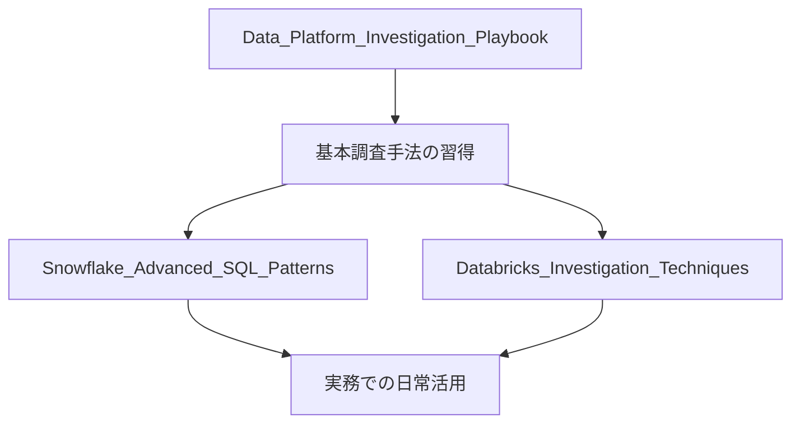
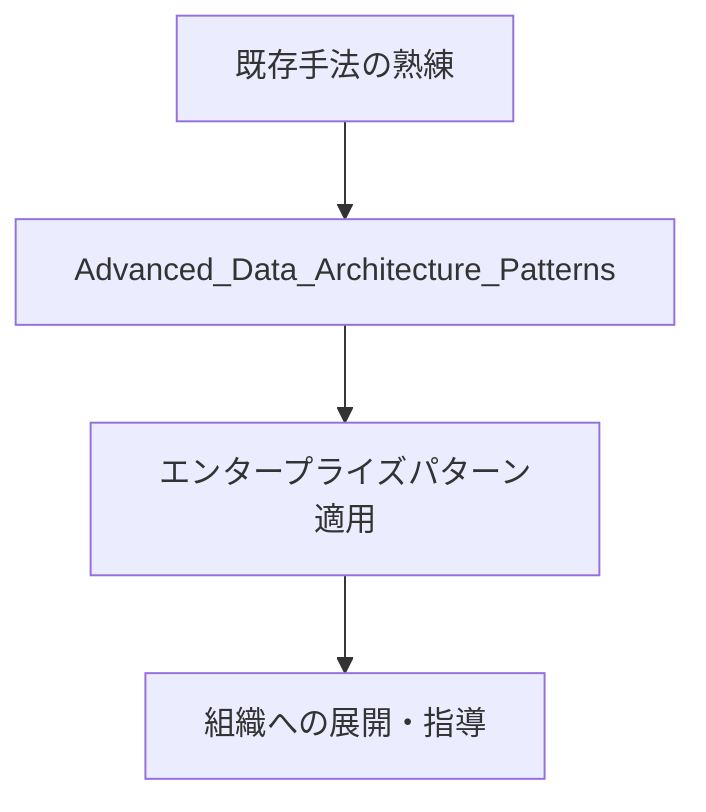
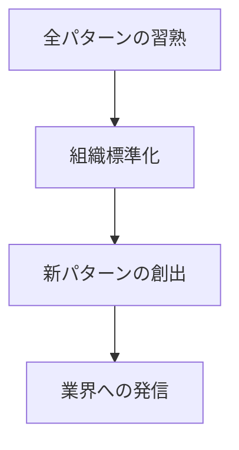

---
tags:
  - best-practices
  - documentation-structure
  - guidance
  - domain/data-platform
created: 2025-06-20
modified: 2025-06-20
---

# DataPlatforms Best Practices Guide

## 🎯 このディレクトリの目的

DataPlatforms Best Practicesは、実務で検証済みの手法・パターン・テクニックを体系的に整理したナレッジベースです。理論的な学習から実践的な問題解決まで、段階的にスキルアップできるよう設計されています。

## 📁 ファイル構成と役割分担

### 🔍 調査・トラブルシューティング系
```
Data_Platform_Investigation_Playbook.md
├── 基本コンセプト: 上流→下流の体系的調査手法
├── 対象: Snowflake + Databricks 共通アプローチ
├── 想定読者: データエンジニア（中級以上）
└── 使用場面: 障害対応、データパイプライン分析、リネージ追跡

Snowflake_Advanced_SQL_Patterns.md
├── 専門領域: Snowflake特化のSQLテクニック集
├── 内容: SHOW→RESULT_SCAN→GET_DDL等の多段コンボ
├── 想定読者: Snowflake実務者（中級〜上級）
└── 使用場面: 日常運用、性能最適化、メタデータ分析

Databricks_Investigation_Techniques.md  # 🆕 今回追加
├── 専門領域: Databricks特化のデバッグ・分析手法
├── 内容: SparkSQL、AQE、Unity Catalog活用
├── 想定読者: Databricks実務者（中級〜上級）
└── 使用場面: ノートブック解析、Spark最適化、ジョブ調査
```

### 🏗️ アーキテクチャ・設計系
```
Advanced_Data_Architecture_Patterns.md
├── 対象: エンタープライズレベルの設計パターン
├── 内容: メダリオン、Event Sourcing、CQRS、Saga
├── 想定読者: アーキテクト、シニアエンジニア
└── 使用場面: システム設計、技術選定、パターン適用
```

## 🎯 学習・活用ルート

### 初学者向け（1-3ヶ月）


### 中級者向け（3-6ヶ月）


### 上級者向け（6ヶ月以上）


## 📊 ファイル間の関係性

```dataview
TABLE WITHOUT ID
    file.link as "📄 ファイル",
    split(tags, ", ") as "🏷️ 主要タグ",
    difficulty as "🎯 難易度",
    experience_level as "📈 検証レベル"
FROM "knowledge-vault/domains/DataPlatforms/20_Permanent/Best_Practices"
WHERE file.name != "README"
SORT difficulty ASC
```

## 🔧 実践的な使い方

### 🚨 障害・インシデント対応時
1. **Data_Platform_Investigation_Playbook** - 全体的な調査フレームワーク
2. **Snowflake_Advanced_SQL_Patterns** または **Databricks_Investigation_Techniques** - プラットフォーム固有の詳細調査

### 📈 性能最適化時
1. 各プラットフォーム専用ファイルで具体的テクニック適用
2. **Advanced_Data_Architecture_Patterns** で根本的な設計見直し

### 🏗️ 新システム設計時
1. **Advanced_Data_Architecture_Patterns** でパターン選定
2. 各プラットフォーム専用ファイルで実装詳細確認

## 📈 スキルレベル評価

### レベル1: 基礎調査スキル
- [ ] SHOW → RESULT_SCAN → GET_DDL の三段活用ができる
- [ ] EXPLAIN、DESCRIBE HISTORYを使った基本分析ができる
- [ ] リネージ追跡の基本手順を理解している

### レベル2: 高度な分析スキル  
- [ ] 複雑なメタデータクエリを組み立てられる
- [ ] 性能問題の根本原因を特定できる
- [ ] 自動化スクリプトを作成できる

### レベル3: アーキテクチャ設計スキル
- [ ] エンタープライズパターンを適用できる
- [ ] 組織のベストプラクティスを策定できる
- [ ] 技術選定・導入を主導できる

## 🔄 継続的改善

### 月次レビュー項目
- [ ] 新しいテクニック・パターンの追加
- [ ] 既存パターンの実績・効果測定
- [ ] ドキュメント構成の最適化
- [ ] 外部情報・最新動向の反映

### 四半期レビュー項目
- [ ] 全ファイルの整合性チェック
- [ ] 学習ルートの見直し
- [ ] 新技術・プラットフォームへの対応
- [ ] 組織での活用状況評価

## 🔗 関連リソース

### 内部リンク
- [[../../Getting_Started]] - DataPlatformsドメイン全体概要
- [[../../30_Projects/Certification/Databricks_Cert_Journey/Databricks_Certified_Data_Engineer_Associate]] - 体系的学習
- [[../../30_Projects/Certification/Snowflake_Cert_Journey/SnowPro_Core_Certification]] - 体系的学習

### 外部リンク
- [Databricks Best Practices](https://docs.databricks.com/best-practices/index.html)
- [Snowflake Best Practices](https://docs.snowflake.com/en/user-guide/best-practices.html)

---

**作成日**: 2025-06-20  
**最終更新**: 2025-06-20  
**メンテナンス周期**: 月次 