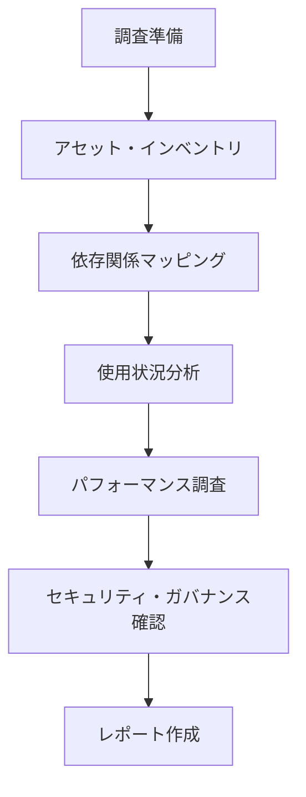
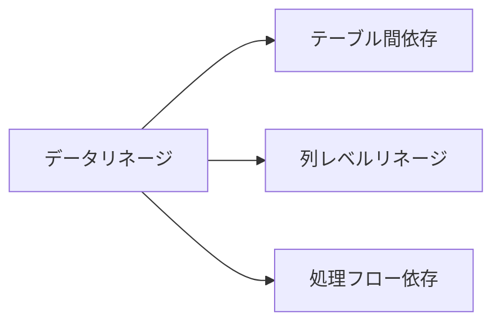

---
tags:
  - methodology/investigation
  - best-practices
  - data-platform
  - metadata-management
  - data-lineage
  - domain/data-platform
created: 2025-06-20
modified: 2025-06-21
difficulty: "Intermediate"
implementation_status: "Production Ready"
version: "2025"
experience_level: "実務検証済み"
---

# データプラットフォーム調査方法論（一般原則）

## 🎯 概要

あらゆるデータプラットフォーム（Snowflake、Databricks、BigQuery、Redshift等）に適用可能な調査方法論。
プラットフォーム固有の実装は別ファイル（Snowflake_Investigation_Methods.md、Databricks_Investigation_Methods.md）を参照。

## 🧠 基本原則と共通マインドセット

### 調査の基本フロー


### 0. 準備フェーズ

| 目的 | 具体策 |
|------|-------|
| **全体像の把握** | パイプラインを「層」で描く（Source-Staging-Transform-Mart-Consume） |
| **再現性** | すべての調査コマンドをノートブック/SQLファイルに残し、Git管理 |
| **最小権限** | 必要最小限の権限セットを管理者と調整 |
| **ドキュメント化** | 調査結果の標準テンプレートを準備 |

#### 事前準備チェックリスト
```markdown
- [ ] 調査対象システムのアクセス権限確認
- [ ] Git リポジトリでの調査ノート管理準備
- [ ] 調査テンプレートファイルの準備
- [ ] BI ツール・外部システム連携の確認
- [ ] 緊急時連絡先の把握
- [ ] セキュリティ・コンプライアンス要件の確認
```

## 📊 1. アセット・インベントリ作成（共通アプローチ）

### 1.1 階層構造の把握
- **カタログ/データベース** → **スキーマ/データセット** → **テーブル/ビュー**
- **ストアドプロシージャ/関数** の分布
- **外部データソース** の接続状況

### 1.2 収集すべきメタデータ項目
| カテゴリ | 必須項目 | 拡張項目 |
|----------|----------|----------|
| **基本情報** | 名前、作成日、所有者 | 説明、タグ、カテゴリ |
| **構造情報** | 列名、データ型、制約 | 統計情報、プロファイル |
| **運用情報** | 最終更新日時、サイズ | アクセス頻度、パフォーマンス |
| **関係情報** | 依存関係、リネージ | 影響度、優先度 |

### 1.3 インベントリ収集の標準手順
1. **トップダウン調査**: カタログ → スキーマ → テーブル の順で全体を把握
2. **ボトムアップ検証**: 重要テーブルから上流・下流を辿る
3. **横断的確認**: 同じデータを異なるスキーマで重複管理していないか
4. **外部連携確認**: ETL/ELTツール、BIツール、アプリケーションとの接続

## 🔍 2. 依存関係マッピング（共通戦略）

### 2.1 リネージ調査の3つのレイヤー


### 2.2 依存関係マッピングの標準アプローチ

#### A. 静的依存関係
- **ビュー定義** からの上流テーブル抽出
- **ストアドプロシージャ** 内のSQL解析
- **ETL/ELTスクリプト** の参照テーブル抽出

#### B. 動的依存関係  
- **クエリ履歴** からの実際の参照パターン
- **アクセスログ** による使用頻度分析
- **処理スケジュール** からの実行順序把握

#### C. 影響度分析
- **下流への影響範囲** 特定
- **ビジネス重要度** による優先順位付け
- **障害時の影響度** 評価

### 2.3 リネージマッピングのベストプラクティス
```markdown
1. **段階的アプローチ**: 重要度の高いテーブルから開始
2. **双方向トレース**: 上流・下流の両方向を調査
3. **外部システム考慮**: データベース外のETL/BIツールも含める
4. **定期更新**: リネージ情報の鮮度管理
```

## 📈 3. 使用状況分析（共通指標）

### 3.1 使用状況KPI
| 指標カテゴリ | 測定項目 | 目的 |
|-------------|----------|------|
| **アクセス頻度** | 日次/週次/月次アクセス数 | 利用度合いの把握 |
| **ユーザー多様性** | ユニークユーザー数、部門分布 | 影響範囲の特定 |
| **クエリパターン** | SELECT/INSERT/UPDATE/DELETE比率 | 利用用途の分析 |
| **時間パターン** | ピーク時間、曜日パターン | リソース計画 |

### 3.2 分析手法
1. **定量分析**: クエリ履歴・アクセスログの統計分析
2. **定性分析**: ユーザーヒアリング・用途調査
3. **トレンド分析**: 時系列での利用パターン変化
4. **異常検知**: 通常と異なるアクセスパターンの特定

## ⚡ 4. パフォーマンス調査（共通観点）

### 4.1 パフォーマンス指標
```markdown
- **実行時間**: 平均・最大・P95実行時間
- **リソース使用量**: CPU・メモリ・ストレージ・ネットワーク
- **同時実行**: 並行クエリ数、ロック・待機状況
- **エラー率**: 失敗率、タイムアウト率
```

### 4.2 ボトルネック特定手法
1. **実行計画分析**: クエリオプティマイザーの実行計画確認
2. **統計情報確認**: テーブル・インデックス統計の最新性
3. **リソース監視**: システムリソースの使用状況
4. **ネットワーク分析**: データ転送・レイテンシ測定

## 🔒 5. セキュリティ・ガバナンス確認

### 5.1 権限管理調査
- **アクセス制御**: ユーザー・ロール・権限の棚卸し
- **最小権限原則**: 過剰権限の特定と是正
- **定期レビュー**: アクセス権限の見直しプロセス

### 5.2 データガバナンス
- **データ分類**: 機密度・重要度による分類
- **データ品質**: 整合性・完全性・正確性の検証
- **コンプライアンス**: 法規制・社内規定への準拠確認

## 📋 6. 調査レポート標準テンプレート

### 6.1 エグゼクティブサマリー
```markdown
## 調査サマリー
- **調査期間**: YYYY/MM/DD - YYYY/MM/DD
- **調査範囲**: [データベース名/スキーマ名]
- **主要発見事項**: [3-5個の要点]
- **推奨アクション**: [優先度付きアクション項目]
```

### 6.2 詳細調査結果
```markdown
## 詳細結果
### アセット一覧
- テーブル数: XXX
- ビュー数: XXX  
- 主要データ量: XXX GB

### 依存関係
- 上流システム: [リスト]
- 下流システム: [リスト]
- クリティカルパス: [重要な依存関係]

### パフォーマンス
- 平均クエリ実行時間: XXX秒
- 最重量クエリ: [トップ10]
- リソース使用状況: [CPU/メモリ/ストレージ]

### リスク・課題
- セキュリティリスク: [発見事項]
- パフォーマンス課題: [ボトルネック]
- ガバナンス課題: [改善点]
```

## 🚀 7. 継続的改善とモニタリング

### 7.1 定期調査サイクル
- **日次**: パフォーマンス監視、エラー確認
- **週次**: 使用状況トレンド分析
- **月次**: リネージ更新、権限レビュー
- **四半期**: 包括的なヘルスチェック

### 7.2 自動化の推進
- **メタデータ収集**: 定期的な自動インベントリ更新
- **異常検知**: しきい値ベースのアラート設定
- **レポート生成**: 標準レポートの自動作成
- **ダッシュボード**: リアルタイム監視画面

## 📚 関連ドキュメント

- **プラットフォーム固有調査**: 
  - [[03_Snowflake_Investigation_Methods]]
  - [[02_Databricks_Investigation_Methods]]
- **アーキテクチャパターン**: [[04_Advanced_Data_Architecture_Patterns]]
- **パフォーマンス最適化**:
  - [[Snowflake/Performance_Optimization_Techniques]]
  - [[Databricks/Spark_Performance_Tuning_Advanced]]

---

**更新履歴**
- 2025-06-21: プラットフォーム非依存の一般原則に再構成
- 2025-06-20: 初版作成 