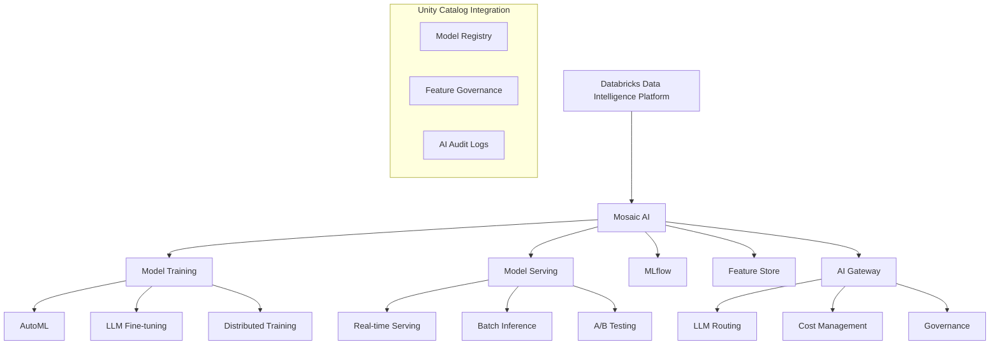

---
tags:
  - tech/mosaic-ai
  - platform/databricks
  - ai-ml/implementation
  - llmops
  - model-serving
  - domain/data-platform
created: 2025-06-20
modified: 2025-06-20
difficulty: "Advanced"
implementation_status: "Production Ready"
version: "2025"
---

# Databricks Mosaic AI実装ガイド（2025年版）

## 🎯 概要

Databricks Mosaic AIは、データ準備からモデル訓練、デプロイ、監視まで、AI/MLワークフロー全体を統合管理するプラットフォームです。2025年版では、LLMOps、Multi-Modal AI、AI Gateway、Advanced Governance機能が強化され、エンタープライズレベルのAI/ML運用を実現します。

## 🏗️ Mosaic AIアーキテクチャ

### 1. コンポーネント構成



### 2. 環境セットアップ

#### 基本設定
```python
import databricks
from databricks import feature_store
from databricks.sdk import WorkspaceClient
from databricks.connect import DatabricksSession
import mlflow
import mlflow.sklearn
from mlflow import MlflowClient

# Databricks接続設定
spark = DatabricksSession.builder.getOrCreate()
w = WorkspaceClient()

# MLflow設定
mlflow.set_registry_uri("databricks-uc")
mlflow.set_tracking_uri("databricks")

# Feature Store初期化
fs = feature_store.FeatureStoreClient()

print("Mosaic AI環境セットアップ完了")
```

#### Unity Catalog統合
```python
def setup_ai_governance(catalog_name="ai_models", schema_name="production"):
    """AI ガバナンス設定"""
    
    # AIモデル用カタログ・スキーマ作成
    spark.sql(f"CREATE CATALOG IF NOT EXISTS {catalog_name}")
    spark.sql(f"CREATE SCHEMA IF NOT EXISTS {catalog_name}.{schema_name}")
    
    # Feature Store用スキーマ
    spark.sql(f"CREATE SCHEMA IF NOT EXISTS {catalog_name}.feature_store")
    
    # 権限設定
    spark.sql(f"""
        GRANT USE CATALOG ON CATALOG {catalog_name} TO `data_science_team`
    """)
    spark.sql(f"""
        GRANT CREATE MODEL ON SCHEMA {catalog_name}.{schema_name} TO `ml_engineers`
    """)
    
    print(f"AI ガバナンス設定完了: {catalog_name}.{schema_name}")

setup_ai_governance()
```

## 🤖 LLM Fine-tuningとLLMOps

### 1. カスタムLLMトレーニング

#### データ準備とプリプロセシング
```python
from transformers import AutoTokenizer, AutoModelForCausalLM
from datasets import Dataset
import torch

def prepare_llm_training_data(raw_data_table, model_name="meta-llama/Llama-2-7b-hf"):
    """LLM学習用データ準備"""
    
    # 生データ読み込み
    raw_df = spark.table(raw_data_table).toPandas()
    
    # トークナイザー初期化
    tokenizer = AutoTokenizer.from_pretrained(model_name)
    if tokenizer.pad_token is None:
        tokenizer.pad_token = tokenizer.eos_token
    
    # テキストデータの前処理
    def preprocess_function(examples):
        # カスタムプロンプト形式
        inputs = [
            f"### Instruction:\n{instruction}\n\n### Input:\n{input_text}\n\n### Response:\n{response}"
            for instruction, input_text, response in zip(
                examples['instruction'], 
                examples['input'], 
                examples['output']
            )
        ]
        
        # トークン化
        model_inputs = tokenizer(
            inputs,
            max_length=2048,
            truncation=True,
            padding=True,
            return_tensors="pt"
        )
        
        # ラベル設定（入力と同じ）
        model_inputs["labels"] = model_inputs["input_ids"].clone()
        
        return model_inputs
    
    # データセット作成
    dataset = Dataset.from_pandas(raw_df)
    tokenized_dataset = dataset.map(
        preprocess_function,
        batched=True,
        remove_columns=dataset.column_names
    )
    
    return tokenized_dataset, tokenizer

# データ準備実行
train_dataset, tokenizer = prepare_llm_training_data("ai_models.feature_store.training_data")
```

#### LoRA Fine-tuning実装
```python
from peft import LoraConfig, get_peft_model, prepare_model_for_kbit_training
from transformers import TrainingArguments, Trainer
import bitsandbytes as bnb

def setup_lora_training(model_name, lora_rank=16, lora_alpha=32):
    """LoRA設定による効率的なファインチューニング"""
    
    # ベースモデル読み込み（4bit量子化）
    model = AutoModelForCausalLM.from_pretrained(
        model_name,
        load_in_4bit=True,
        bnb_4bit_compute_dtype=torch.float16,
        bnb_4bit_use_double_quant=True,
        bnb_4bit_quant_type="nf4",
        device_map="auto"
    )
    
    # LoRA設定
    lora_config = LoraConfig(
        r=lora_rank,
        lora_alpha=lora_alpha,
        target_modules=["q_proj", "v_proj", "k_proj", "o_proj"],
        lora_dropout=0.1,
        bias="none",
        task_type="CAUSAL_LM"
    )
    
    # モデル準備
    model = prepare_model_for_kbit_training(model)
    model = get_peft_model(model, lora_config)
    
    return model

def train_custom_llm(train_dataset, model, tokenizer, output_dir="./custom_llm"):
    """カスタムLLMトレーニング実行"""
    
    # 学習設定
    training_args = TrainingArguments(
        output_dir=output_dir,
        num_train_epochs=3,
        per_device_train_batch_size=4,
        gradient_accumulation_steps=2,
        warmup_steps=100,
        max_steps=1000,
        learning_rate=2e-4,
        fp16=True,
        logging_steps=50,
        save_strategy="steps",
        save_steps=200,
        evaluation_strategy="steps",
        eval_steps=200,
        do_eval=True,
        report_to="mlflow"  # MLflow統合
    )
    
    # トレーナー設定
    trainer = Trainer(
        model=model,
        args=training_args,
        train_dataset=train_dataset,
        eval_dataset=train_dataset.select(range(100)),  # 評価用サンプル
        tokenizer=tokenizer,
        data_collator=lambda batch: {
            'input_ids': torch.stack([item['input_ids'] for item in batch]),
            'attention_mask': torch.stack([item['attention_mask'] for item in batch]),
            'labels': torch.stack([item['labels'] for item in batch])
        }
    )
    
    # MLflow実験開始
    with mlflow.start_run():
        mlflow.log_params({
            "model_name": model.config.name_or_path,
            "lora_rank": lora_config.r,
            "lora_alpha": lora_config.lora_alpha,
            "learning_rate": training_args.learning_rate,
            "batch_size": training_args.per_device_train_batch_size
        })
        
        # トレーニング実行
        trainer.train()
        
        # モデル保存
        trainer.save_model()
        
        # MLflowにモデル登録
        mlflow.transformers.log_model(
            transformers_model={
                "model": model,
                "tokenizer": tokenizer
            },
            artifact_path="model",
            registered_model_name="custom_llm_v1"
        )
    
    return trainer

# ファインチューニング実行
model = setup_lora_training("meta-llama/Llama-2-7b-hf")
trainer = train_custom_llm(train_dataset, model, tokenizer)
```

### 2. LLMOps Pipeline

#### 自動化されたLLMワークフロー
```python
from databricks.sdk.service.jobs import JobSettings, NotebookTask, JobCluster
import json

def create_llmops_pipeline(model_name, training_data_table):
    """LLMOpsパイプライン作成"""
    
    # Job設定
    job_config = {
        "name": f"LLMOps_Pipeline_{model_name}",
        "job_clusters": [{
            "job_cluster_key": "llm_cluster",
            "new_cluster": {
                "spark_version": "13.3.x-gpu-ml-scala2.12",
                "node_type_id": "g5.xlarge",
                "num_workers": 2,
                "aws_attributes": {
                    "zone_id": "us-west-2a"
                }
            }
        }],
        "tasks": [
            {
                "task_key": "data_preparation",
                "job_cluster_key": "llm_cluster",
                "notebook_task": {
                    "notebook_path": "/Workspace/llmops/data_preparation",
                    "base_parameters": {
                        "source_table": training_data_table,
                        "model_name": model_name
                    }
                }
            },
            {
                "task_key": "model_training",
                "depends_on": [{"task_key": "data_preparation"}],
                "job_cluster_key": "llm_cluster",
                "notebook_task": {
                    "notebook_path": "/Workspace/llmops/model_training",
                    "base_parameters": {
                        "model_name": model_name,
                        "experiment_name": f"/Users/ml_team/llm_experiments/{model_name}"
                    }
                }
            },
            {
                "task_key": "model_evaluation",
                "depends_on": [{"task_key": "model_training"}],
                "job_cluster_key": "llm_cluster",
                "notebook_task": {
                    "notebook_path": "/Workspace/llmops/model_evaluation"
                }
            },
            {
                "task_key": "model_deployment",
                "depends_on": [{"task_key": "model_evaluation"}],
                "job_cluster_key": "llm_cluster",
                "notebook_task": {
                    "notebook_path": "/Workspace/llmops/model_deployment"
                }
            }
        ],
        "email_notifications": {
            "on_failure": ["ml-team@company.com"],
            "on_success": ["ml-team@company.com"]
        }
    }
    
    # Job作成
    job = w.jobs.create(**job_config)
    print(f"LLMOps Pipeline created: Job ID {job.job_id}")
    
    return job.job_id

# パイプライン作成実行
pipeline_id = create_llmops_pipeline(
    model_name="custom_customer_support_llm",
    training_data_table="ai_models.feature_store.support_conversations"
)
```

## 🚀 Model Serving

### 1. リアルタイムモデルサービング

#### エンドポイント作成と設定
```python
from databricks.sdk.service.serving import (
    CreateServingEndpoint, 
    EndpointCoreConfig,
    ServedModelInput,
    ServedModelScale,
    ServedModelSpec
)

def create_model_serving_endpoint(model_name, model_version="latest"):
    """モデルサービングエンドポイント作成"""
    
    endpoint_config = CreateServingEndpoint(
        name=f"serving-{model_name}",
        config=EndpointCoreConfig(
            served_models=[
                ServedModelInput(
                    model_name=model_name,
                    model_version=model_version,
                    workload_type="GPU_MEDIUM",
                    workload_size="Small",
                    scale_to_zero_enabled=True
                )
            ],
            traffic_config={
                "routes": [
                    {
                        "served_model_name": f"{model_name}-{model_version}",
                        "traffic_percentage": 100
                    }
                ]
            }
        )
    )
    
    # エンドポイント作成
    endpoint = w.serving_endpoints.create_and_wait(endpoint_config)
    print(f"Serving endpoint created: {endpoint.name}")
    
    return endpoint

def deploy_model_with_ab_testing(model_name, challenger_version, champion_version="latest"):
    """A/Bテスト付きモデルデプロイ"""
    
    # A/Bテスト設定
    ab_config = EndpointCoreConfig(
        served_models=[
            # Champion model (90% traffic)
            ServedModelInput(
                model_name=model_name,
                model_version=champion_version,
                workload_type="GPU_MEDIUM",
                workload_size="Small",
                scale_to_zero_enabled=True,
                served_model_name=f"champion-{champion_version}"
            ),
            # Challenger model (10% traffic)
            ServedModelInput(
                model_name=model_name,
                model_version=challenger_version,
                workload_type="GPU_MEDIUM",
                workload_size="Small",
                scale_to_zero_enabled=True,
                served_model_name=f"challenger-{challenger_version}"
            )
        ],
        traffic_config={
            "routes": [
                {
                    "served_model_name": f"champion-{champion_version}",
                    "traffic_percentage": 90
                },
                {
                    "served_model_name": f"challenger-{challenger_version}",
                    "traffic_percentage": 10
                }
            ]
        }
    )
    
    # エンドポイント更新
    endpoint_name = f"serving-{model_name}"
    w.serving_endpoints.update_config_and_wait(
        name=endpoint_name,
        served_models=ab_config.served_models,
        traffic_config=ab_config.traffic_config
    )
    
    print(f"A/B testing deployed: Champion {champion_version} (90%) vs Challenger {challenger_version} (10%)")

# モデルサービング実行
endpoint = create_model_serving_endpoint("custom_customer_support_llm")
```

### 2. 高度なサービング機能

#### 動的バッチサイズ最適化
```python
def optimize_serving_performance(endpoint_name, target_latency_ms=500):
    """サービング性能最適化"""
    
    # 現在の性能メトリクス取得
    metrics = w.serving_endpoints.get_serving_endpoint_metrics(
        name=endpoint_name,
        start_time="2024-01-01T00:00:00Z",
        end_time="2024-12-31T23:59:59Z"
    )
    
    # 性能分析
    avg_latency = sum(m.latency_p99 for m in metrics.metrics) / len(metrics.metrics)
    avg_throughput = sum(m.throughput for m in metrics.metrics) / len(metrics.metrics)
    
    print(f"Current Performance - Latency: {avg_latency}ms, Throughput: {avg_throughput} req/s")
    
    # 性能改善提案
    recommendations = []
    
    if avg_latency > target_latency_ms:
        recommendations.extend([
            "Consider scaling up workload size",
            "Enable model optimization (quantization/pruning)",
            "Use GPU-accelerated instances"
        ])
    
    if avg_throughput < 10:  # 10 req/s未満
        recommendations.extend([
            "Enable auto-scaling",
            "Consider batch inference for high-volume scenarios"
        ])
    
    return {
        "current_latency": avg_latency,
        "current_throughput": avg_throughput,
        "recommendations": recommendations
    }

# カスタム推論クラス
class OptimizedModelWrapper(mlflow.pyfunc.PythonModel):
    def __init__(self):
        self.model = None
        self.tokenizer = None
        self.cache = {}
        
    def load_context(self, context):
        """モデル読み込み時の最適化"""
        import torch
        
        # モデル読み込み
        model_path = context.artifacts["model"]
        self.model = torch.jit.load(model_path)  # TorchScript最適化
        
        # キャッシュ設定
        self.cache = {}
        
    def predict(self, context, model_input):
        """最適化された推論"""
        import hashlib
        
        # 入力テキストのハッシュ計算（キャッシュ用）
        input_hash = hashlib.md5(str(model_input).encode()).hexdigest()
        
        # キャッシュチェック
        if input_hash in self.cache:
            return self.cache[input_hash]
        
        # バッチ処理最適化
        if isinstance(model_input, list) and len(model_input) > 1:
            results = self._batch_predict(model_input)
        else:
            results = self._single_predict(model_input)
        
        # 結果をキャッシュ
        self.cache[input_hash] = results
        
        # キャッシュサイズ制限
        if len(self.cache) > 1000:
            oldest_key = next(iter(self.cache))
            del self.cache[oldest_key]
        
        return results
    
    def _batch_predict(self, inputs):
        """バッチ推論最適化"""
        # バッチサイズを動的調整
        optimal_batch_size = min(len(inputs), 32)
        results = []
        
        for i in range(0, len(inputs), optimal_batch_size):
            batch = inputs[i:i + optimal_batch_size]
            batch_results = self.model(batch)
            results.extend(batch_results)
        
        return results
    
    def _single_predict(self, input_data):
        """単一推論"""
        return self.model(input_data)
```

## 🎯 Feature Store統合

### 1. フィーチャー管理

#### フィーチャーテーブル作成
```python
from databricks.feature_store import FeatureStoreClient, feature_table
from pyspark.sql.functions import *
from pyspark.sql.types import *

fs = FeatureStoreClient()

def create_customer_features():
    """顧客フィーチャーテーブル作成"""
    
    # フィーチャー計算
    customer_features = spark.sql("""
        SELECT 
            customer_id,
            COUNT(*) as total_orders,
            SUM(amount) as total_spent,
            AVG(amount) as avg_order_value,
            DATEDIFF(CURRENT_DATE(), MAX(order_date)) as days_since_last_order,
            PERCENTILE_CONT(0.5) WITHIN GROUP (ORDER BY amount) as median_order_value,
            COUNT(DISTINCT product_category) as categories_purchased,
            STDDEV(amount) as order_value_std,
            MAX(order_date) as last_order_date,
            MIN(order_date) as first_order_date,
            CURRENT_TIMESTAMP() as feature_timestamp
        FROM sales_data
        WHERE order_date >= '2024-01-01'
        GROUP BY customer_id
    """)
    
    # フィーチャーテーブル作成
    customer_feature_table = fs.create_table(
        name="ai_models.feature_store.customer_features",
        primary_keys=["customer_id"],
        df=customer_features,
        description="Customer behavioral features for ML models"
    )
    
    return customer_feature_table

def create_realtime_features():
    """リアルタイムフィーチャー計算"""
    
    # ストリーミングフィーチャーテーブル
    realtime_features = spark.readStream \
        .format("kafka") \
        .option("kafka.bootstrap.servers", "kafka-server:9092") \
        .option("subscribe", "customer_events") \
        .load() \
        .select(
            from_json(col("value").cast("string"), 
                     StructType([
                         StructField("customer_id", StringType()),
                         StructField("event_type", StringType()),
                         StructField("timestamp", TimestampType()),
                         StructField("amount", DoubleType())
                     ])).alias("event")
        ) \
        .select("event.*") \
        .withWatermark("timestamp", "10 minutes") \
        .groupBy(
            window(col("timestamp"), "5 minutes"),
            col("customer_id")
        ) \
        .agg(
            count("*").alias("event_count_5min"),
            sum("amount").alias("total_amount_5min"),
            avg("amount").alias("avg_amount_5min")
        ) \
        .select(
            col("customer_id"),
            col("event_count_5min"),
            col("total_amount_5min"),
            col("avg_amount_5min"),
            current_timestamp().alias("feature_timestamp")
        )
    
    # ストリーミング書き込み
    query = fs.write_table(
        name="ai_models.feature_store.realtime_customer_features",
        df=realtime_features,
        mode="merge"
    )
    
    return query

# フィーチャーテーブル作成実行
customer_features = create_customer_features()
```

### 2. フィーチャー品質管理

#### データ品質監視
```python
from databricks.feature_store.utils import FeatureStoreUtils
import great_expectations as ge

def monitor_feature_quality(feature_table_name):
    """フィーチャー品質監視"""
    
    # フィーチャーテーブル読み込み
    feature_df = fs.read_table(feature_table_name)
    
    # Great Expectations設定
    ge_df = ge.from_pandas(feature_df.toPandas())
    
    # データ品質チェック
    expectation_suite = {
        "total_orders": {
            "expect_column_values_to_be_between": {"min_value": 0, "max_value": 10000},
            "expect_column_values_to_not_be_null": {}
        },
        "total_spent": {
            "expect_column_values_to_be_between": {"min_value": 0, "max_value": 1000000},
            "expect_column_values_to_not_be_null": {}
        },
        "avg_order_value": {
            "expect_column_values_to_be_between": {"min_value": 0, "max_value": 10000}
        }
    }
    
    # 品質チェック実行
    quality_results = {}
    for column, expectations in expectation_suite.items():
        column_results = {}
        for expectation, params in expectations.items():
            result = getattr(ge_df, expectation)(column, **params)
            column_results[expectation] = result.success
        quality_results[column] = column_results
    
    # 結果をMLflowに記録
    with mlflow.start_run():
        mlflow.log_metrics({
            f"quality_{col}_{exp}": result 
            for col, expectations in quality_results.items()
            for exp, result in expectations.items()
        })
    
    return quality_results

def automated_feature_drift_detection(feature_table_name, baseline_days=30):
    """フィーチャードリフト検出"""
    
    # ベースライン期間のデータ
    baseline_df = spark.sql(f"""
        SELECT *
        FROM {feature_table_name}
        WHERE feature_timestamp >= current_date() - interval {baseline_days + 7} days
            AND feature_timestamp < current_date() - interval 7 days
    """)
    
    # 現在のデータ
    current_df = spark.sql(f"""
        SELECT *
        FROM {feature_table_name}
        WHERE feature_timestamp >= current_date() - interval 7 days
    """)
    
    # 統計比較
    numerical_columns = ["total_orders", "total_spent", "avg_order_value"]
    drift_results = {}
    
    for column in numerical_columns:
        baseline_stats = baseline_df.select(
            avg(column).alias("baseline_mean"),
            stddev(column).alias("baseline_std")
        ).collect()[0]
        
        current_stats = current_df.select(
            avg(column).alias("current_mean"),
            stddev(column).alias("current_std")
        ).collect()[0]
        
        # ドリフト計算（標準化された差分）
        mean_drift = abs(current_stats.current_mean - baseline_stats.baseline_mean) / baseline_stats.baseline_std
        
        drift_results[column] = {
            "drift_score": mean_drift,
            "is_drifted": mean_drift > 2.0,  # 2標準偏差以上
            "baseline_mean": baseline_stats.baseline_mean,
            "current_mean": current_stats.current_mean
        }
    
    return drift_results

# 品質監視実行
quality_report = monitor_feature_quality("ai_models.feature_store.customer_features")
drift_report = automated_feature_drift_detection("ai_models.feature_store.customer_features")
```

## 🛡️ AI Gateway とガバナンス

### 1. AI Gateway設定

#### LLMルーティングと制御
```python
from databricks.sdk.service.serving import ChatMessage, ChatRequest

class AIGatewayManager:
    def __init__(self, workspace_client):
        self.w = workspace_client
        
    def create_gateway_endpoint(self, name, models_config):
        """AI Gatewayエンドポイント作成"""
        
        gateway_config = {
            "name": name,
            "config": {
                "served_models": models_config,
                "rate_limits": [
                    {
                        "calls": 1000,
                        "renewal_period": "minute",
                        "key": "user"
                    }
                ],
                "usage_tracking_config": {
                    "enabled": True
                }
            }
        }
        
        endpoint = self.w.serving_endpoints.create(gateway_config)
        return endpoint
    
    def route_request_with_logic(self, request, routing_logic="cost_optimized"):
        """インテリジェントルーティング"""
        
        # リクエスト分析
        request_complexity = self._analyze_request_complexity(request)
        user_tier = self._get_user_tier(request.get('user_id'))
        
        # ルーティング決定
        if routing_logic == "cost_optimized":
            if request_complexity < 0.3:
                target_model = "gpt-3.5-turbo"  # 安価なモデル
            else:
                target_model = "gpt-4"  # 高性能モデル
        elif routing_logic == "performance_optimized":
            target_model = "gpt-4" if user_tier == "premium" else "gpt-3.5-turbo"
        else:
            target_model = "gpt-3.5-turbo"  # デフォルト
        
        # リクエストログ記録
        self._log_routing_decision(request, target_model, request_complexity)
        
        return target_model
    
    def _analyze_request_complexity(self, request):
        """リクエスト複雑度分析"""
        text = request.get('messages', [{}])[-1].get('content', '')
        
        # 簡単な複雑度スコア計算
        complexity_score = 0.0
        complexity_score += len(text) / 1000  # 長さ
        complexity_score += text.count('?') * 0.1  # 質問数
        complexity_score += len(text.split('code')) * 0.2  # コード関連
        
        return min(complexity_score, 1.0)
    
    def _get_user_tier(self, user_id):
        """ユーザーティア取得"""
        # 実際の実装では、ユーザーデータベースから取得
        return "premium" if user_id in ["admin", "enterprise_user"] else "standard"
    
    def _log_routing_decision(self, request, target_model, complexity):
        """ルーティング決定ログ"""
        log_data = {
            "timestamp": spark.sql("SELECT current_timestamp()").collect()[0][0],
            "user_id": request.get('user_id'),
            "target_model": target_model,
            "complexity_score": complexity,
            "request_tokens": len(str(request).split())
        }
        
        # Unity Catalogテーブルにログ保存
        log_df = spark.createDataFrame([log_data])
        log_df.write.mode("append").saveAsTable("ai_models.logs.gateway_routing")

# AI Gateway設定
gateway_manager = AIGatewayManager(w)
```

### 2. 包括的AIガバナンス

#### モデル監査とコンプライアンス
```python
from datetime import datetime, timedelta
import json

class AIGovernanceFramework:
    def __init__(self, spark_session, mlflow_client):
        self.spark = spark_session
        self.mlflow = mlflow_client
        
    def audit_model_usage(self, days_back=30):
        """モデル使用量監査"""
        
        # モデルサービング使用状況
        serving_logs = self.spark.sql(f"""
            SELECT 
                model_name,
                model_version,
                endpoint_name,
                DATE_TRUNC('day', request_timestamp) as date,
                COUNT(*) as request_count,
                AVG(latency_ms) as avg_latency,
                SUM(CASE WHEN status_code != 200 THEN 1 ELSE 0 END) as error_count,
                COUNT(DISTINCT user_id) as unique_users
            FROM ai_models.logs.model_serving
            WHERE request_timestamp >= current_date() - interval {days_back} days
            GROUP BY 1, 2, 3, 4
            ORDER BY date DESC, request_count DESC
        """)
        
        # モデル学習監査
        training_logs = self.spark.sql(f"""
            SELECT 
                experiment_name,
                model_name,
                user_name,
                DATE_TRUNC('day', start_time) as date,
                COUNT(*) as training_runs,
                AVG(duration_minutes) as avg_duration,
                SUM(compute_cost) as total_cost
            FROM ai_models.logs.model_training
            WHERE start_time >= current_date() - interval {days_back} days
            GROUP BY 1, 2, 3, 4
            ORDER BY date DESC, total_cost DESC
        """)
        
        return {
            "serving_audit": serving_logs.toPandas(),
            "training_audit": training_logs.toPandas()
        }
    
    def compliance_check(self, model_name, model_version):
        """コンプライアンスチェック"""
        
        checks = {}
        
        # 1. データ使用許可チェック
        model_info = self.mlflow.get_model_version(model_name, model_version)
        training_data_sources = json.loads(
            model_info.tags.get("training_data_sources", "[]")
        )
        
        checks["data_compliance"] = self._check_data_usage_permissions(training_data_sources)
        
        # 2. モデル性能要件チェック
        latest_metrics = self.mlflow.get_run(model_info.run_id).data.metrics
        
        checks["performance_compliance"] = {
            "accuracy_threshold": latest_metrics.get("accuracy", 0) >= 0.85,
            "bias_check": latest_metrics.get("bias_score", 1.0) <= 0.1,
            "fairness_score": latest_metrics.get("fairness_score", 0) >= 0.8
        }
        
        # 3. セキュリティチェック
        checks["security_compliance"] = {
            "encryption_enabled": model_info.tags.get("encryption", "false") == "true",
            "access_logged": model_info.tags.get("access_logging", "false") == "true",
            "pii_scrubbed": model_info.tags.get("pii_scrubbed", "false") == "true"
        }
        
        # 4. 運用準備チェック
        checks["operational_readiness"] = {
            "monitoring_enabled": self._check_monitoring_setup(model_name),
            "alerting_configured": self._check_alerting_setup(model_name),
            "rollback_plan": model_info.tags.get("rollback_plan", "false") == "true"
        }
        
        # 総合判定
        all_passed = all(
            all(check.values()) if isinstance(check, dict) else check
            for check in checks.values()
        )
        
        checks["overall_compliance"] = all_passed
        
        return checks
    
    def _check_data_usage_permissions(self, data_sources):
        """データ使用許可確認"""
        permissions = {}
        
        for source in data_sources:
            # Unity Catalogからアクセス権限確認
            try:
                self.spark.sql(f"DESCRIBE TABLE {source}")
                permissions[source] = True
            except Exception:
                permissions[source] = False
        
        return all(permissions.values())
    
    def _check_monitoring_setup(self, model_name):
        """監視設定確認"""
        try:
            monitoring_config = self.spark.sql(f"""
                SELECT * FROM ai_models.config.model_monitoring
                WHERE model_name = '{model_name}'
            """).collect()
            return len(monitoring_config) > 0
        except:
            return False
    
    def _check_alerting_setup(self, model_name):
        """アラート設定確認"""
        try:
            alert_config = self.spark.sql(f"""
                SELECT * FROM ai_models.config.model_alerts
                WHERE model_name = '{model_name}'
            """).collect()
            return len(alert_config) > 0
        except:
            return False
    
    def generate_governance_report(self, days_back=30):
        """ガバナンスレポート生成"""
        
        # 監査データ取得
        audit_data = self.audit_model_usage(days_back)
        
        # 全モデルのコンプライアンスチェック
        models = self.mlflow.search_model_versions("")
        compliance_summary = {}
        
        for model in models[:10]:  # 上位10モデル
            try:
                compliance = self.compliance_check(model.name, model.version)
                compliance_summary[f"{model.name}:v{model.version}"] = compliance["overall_compliance"]
            except Exception as e:
                compliance_summary[f"{model.name}:v{model.version}"] = False
        
        # レポート生成
        report = {
            "report_date": datetime.now().isoformat(),
            "audit_period_days": days_back,
            "serving_summary": {
                "total_requests": audit_data["serving_audit"]["request_count"].sum(),
                "unique_models": audit_data["serving_audit"]["model_name"].nunique(),
                "avg_latency": audit_data["serving_audit"]["avg_latency"].mean(),
                "error_rate": audit_data["serving_audit"]["error_count"].sum() / audit_data["serving_audit"]["request_count"].sum()
            },
            "training_summary": {
                "total_runs": audit_data["training_audit"]["training_runs"].sum(),
                "total_cost": audit_data["training_audit"]["total_cost"].sum(),
                "unique_users": audit_data["training_audit"]["user_name"].nunique()
            },
            "compliance_summary": {
                "total_models_checked": len(compliance_summary),
                "compliant_models": sum(compliance_summary.values()),
                "compliance_rate": sum(compliance_summary.values()) / len(compliance_summary) if compliance_summary else 0,
                "non_compliant_models": [k for k, v in compliance_summary.items() if not v]
            }
        }
        
        # レポートをUnity Catalogに保存
        report_df = self.spark.createDataFrame([{
            "report_date": report["report_date"],
            "report_data": json.dumps(report)
        }])
        report_df.write.mode("append").saveAsTable("ai_models.reports.governance_reports")
        
        return report

# ガバナンスフレームワーク初期化
governance = AIGovernanceFramework(spark, MlflowClient())
```

## 🔗 関連リソース

### 内部リンク
- [[Unity_Catalog_Implementation_Guide]] - ガバナンス統合
- [[Delta_Lake_Advanced_Operations]] - データ管理
- [[Databricks_Data_Intelligence_Platform_2025]] - プラットフォーム概要

### 外部リンク
- [Databricks Mosaic AI Documentation](https://docs.databricks.com/machine-learning/)
- [MLflow Documentation](https://mlflow.org/docs/latest/index.html)
- [Databricks Feature Store Guide](https://docs.databricks.com/machine-learning/feature-store/)

---

**実装難易度**: Advanced  
**推奨チーム**: Data Science + ML Engineering  
**想定実装期間**: 6-12週間  
**メンテナンス頻度**: 月次 