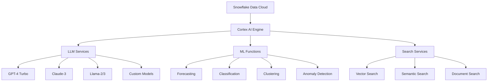

---
tags:
  - tech/cortex-ai
  - platform/snowflake
  - ai-ml/implementation
  - llm/integration
  - domain/data-platform
created: 2025-06-20
modified: 2025-06-20
difficulty: "Advanced"
implementation_status: "Production Ready"
version: "2025"
---

# Snowflake Cortex AI実装ガイド（2025年版）

## 🎯 概要

Snowflake Cortex AIは、LLM（Large Language Model）、ML推論、自然言語処理を直接データウェアハウス内で実行できる統合AI/MLプラットフォームです。2025年版では、カスタムモデル、RAG（Retrieval-Augmented Generation）、リアルタイム推論機能が大幅に強化されています。

## 🏗️ Cortex AIアーキテクチャ

### 1. コンポーネント概要



### 2. 基本設定と有効化

#### Cortex AI有効化
```sql
-- Account管理者権限が必要
ALTER ACCOUNT SET CORTEX_ENABLED = TRUE;

-- データベースレベルでの設定
USE DATABASE production_db;
CREATE SCHEMA IF NOT EXISTS cortex_ai;

-- 必要な権限付与
GRANT USAGE ON DATABASE production_db TO ROLE data_scientist;
GRANT USAGE ON SCHEMA cortex_ai TO ROLE data_scientist;
GRANT CREATE FUNCTION ON SCHEMA cortex_ai TO ROLE data_scientist;
```

#### 利用可能なLLMモデル確認
```sql
-- 利用可能なモデル一覧
SELECT 
    model_name,
    model_version,
    model_type,
    max_tokens,
    supported_languages
FROM snowflake.cortex.available_models()
ORDER BY model_name;

-- モデル詳細情報
DESCRIBE FUNCTION snowflake.cortex.complete;
```

## 🤖 LLM統合と自然言語処理

### 1. 基本的なLLM関数

#### テキスト生成
```sql
-- 基本的なテキスト生成
SELECT snowflake.cortex.complete(
    'llama2-70b-chat',
    'データ分析レポートの要約を作成してください。売上は前年比15%増加し、顧客満足度は4.2/5.0でした。'
) as generated_summary;

-- プロンプトテンプレートを使用
WITH prompts AS (
    SELECT 
        customer_id,
        total_orders,
        avg_order_value,
        CONCAT(
            'Customer ID: ', customer_id, 
            ', Total Orders: ', total_orders,
            ', Average Order Value: $', avg_order_value,
            '. この顧客データに基づいて、マーケティング戦略を提案してください。'
        ) as prompt
    FROM customer_summary
    WHERE total_orders > 10
)
SELECT 
    customer_id,
    snowflake.cortex.complete('gpt-4-turbo', prompt) as marketing_strategy
FROM prompts;
```

#### テキスト分類・感情分析
```sql
-- 感情分析
SELECT 
    review_id,
    review_text,
    snowflake.cortex.sentiment(review_text) as sentiment_score,
    snowflake.cortex.classify_text(
        review_text,
        ['positive', 'negative', 'neutral']
    ) as sentiment_category
FROM customer_reviews
WHERE review_date >= '2025-06-01';

-- カスタム分類器
CREATE OR REPLACE FUNCTION classify_support_ticket(ticket_text STRING)
RETURNS STRING
AS $$
    snowflake.cortex.classify_text(
        ticket_text,
        ['technical_issue', 'billing_inquiry', 'feature_request', 'complaint', 'compliment']
    )
$$;

-- 分類結果の集計
SELECT 
    classify_support_ticket(description) as ticket_category,
    COUNT(*) as ticket_count,
    AVG(resolution_time_hours) as avg_resolution_time
FROM support_tickets
WHERE created_date >= current_date() - interval '30 days'
GROUP BY 1
ORDER BY 2 DESC;
```

### 2. 高度な自然言語クエリ

#### SQLクエリ生成
```sql
-- 自然言語からSQLクエリ生成
CREATE OR REPLACE FUNCTION generate_sql_from_natural_language(
    natural_query STRING,
    table_schema STRING
)
RETURNS STRING
AS $$
    snowflake.cortex.complete(
        'gpt-4-turbo',
        CONCAT(
            'Convert this natural language query to SQL: "', natural_query, '"',
            ' Schema information: ', table_schema,
            ' Return only the SQL query without explanation.'
        )
    )
$$;

-- 使用例
WITH schema_info AS (
    SELECT 'sales_data table has columns: customer_id, product_name, order_date, amount, region' as schema_desc
)
SELECT generate_sql_from_natural_language(
    '売上金額が1000ドル以上の注文を地域別に集計して',
    schema_desc
) as generated_sql
FROM schema_info;
```

#### インテリジェントなデータ探索
```sql
-- データ品質チェック関数
CREATE OR REPLACE FUNCTION ai_data_quality_check(
    table_name STRING,
    column_name STRING
)
RETURNS OBJECT
AS $$
    WITH data_stats AS (
        SELECT 
            COUNT(*) as total_rows,
            COUNT(column_name) as non_null_count,
            COUNT(DISTINCT column_name) as unique_count
        FROM identifier(table_name)
    ),
    analysis_prompt AS (
        SELECT CONCAT(
            'Analyze data quality for column "', column_name, '" in table "', table_name, '":',
            ' Total rows: ', total_rows,
            ', Non-null values: ', non_null_count,
            ', Unique values: ', unique_count,
            '. Provide quality assessment and recommendations in JSON format.',
            ' Include: completeness_score, uniqueness_score, recommendations'
        ) as prompt
        FROM data_stats
    )
    SELECT PARSE_JSON(
        snowflake.cortex.complete('gpt-4-turbo', prompt)
    ) as quality_assessment
    FROM analysis_prompt
$$;
```

## 🔍 RAG（Retrieval-Augmented Generation）実装

### 1. ベクターデータベース設定

#### ベクター埋め込み生成
```sql
-- ドキュメント埋め込みテーブル作成
CREATE OR REPLACE TABLE document_embeddings (
    doc_id STRING,
    doc_title STRING,
    doc_content STRING,
    content_embedding VECTOR(FLOAT, 1536),  -- OpenAI embedding size
    created_at TIMESTAMP DEFAULT CURRENT_TIMESTAMP()
);

-- テキスト埋め込み生成
CREATE OR REPLACE FUNCTION generate_embedding(text_content STRING)
RETURNS VECTOR(FLOAT, 1536)
AS $$
    snowflake.cortex.embed_text('text-embedding-ada-002', text_content)
$$;

-- ドキュメントの埋め込み生成と保存
INSERT INTO document_embeddings (doc_id, doc_title, doc_content, content_embedding)
SELECT 
    document_id,
    title,
    content,
    generate_embedding(CONCAT(title, ' ', content)) as embedding
FROM knowledge_base_documents;
```

#### セマンティック検索実装
```sql
-- セマンティック検索関数
CREATE OR REPLACE FUNCTION semantic_search(
    query_text STRING,
    top_k INTEGER DEFAULT 5
)
RETURNS TABLE (doc_id STRING, doc_title STRING, similarity_score FLOAT)
AS $$
    WITH query_embedding AS (
        SELECT generate_embedding(query_text) as query_vec
    ),
    similarities AS (
        SELECT 
            de.doc_id,
            de.doc_title,
            VECTOR_COSINE_SIMILARITY(de.content_embedding, qe.query_vec) as similarity_score
        FROM document_embeddings de
        CROSS JOIN query_embedding qe
    )
    SELECT doc_id, doc_title, similarity_score
    FROM similarities
    ORDER BY similarity_score DESC
    LIMIT top_k
$$;

-- 検索実行例
SELECT * FROM TABLE(semantic_search('データベース性能最適化の方法', 10));
```

### 2. RAGシステム構築

#### コンテキスト強化回答生成
```sql
CREATE OR REPLACE FUNCTION rag_enhanced_answer(
    user_question STRING,
    context_docs_limit INTEGER DEFAULT 3
)
RETURNS STRING
AS $$
    WITH relevant_docs AS (
        SELECT doc_content
        FROM TABLE(semantic_search(user_question, context_docs_limit))
        JOIN document_embeddings USING (doc_id)
    ),
    context_text AS (
        SELECT LISTAGG(doc_content, '\n\n') as combined_context
        FROM relevant_docs
    ),
    enhanced_prompt AS (
        SELECT CONCAT(
            'Context information:\n',
            combined_context,
            '\n\nQuestion: ', user_question,
            '\n\nPlease answer the question based on the provided context. ',
            'If the context doesn\'t contain relevant information, say so clearly.'
        ) as prompt
        FROM context_text
    )
    SELECT snowflake.cortex.complete('gpt-4-turbo', prompt) as answer
    FROM enhanced_prompt
$$;

-- RAG回答生成例
SELECT rag_enhanced_answer(
    'Snowflakeでクエリ性能を向上させる最良の方法は何ですか？'
) as ai_answer;
```

## 📊 ML推論とアナリティクス

### 1. 時系列予測

#### 自動予測モデル
```sql
-- 時系列予測用のテーブル準備
CREATE OR REPLACE TABLE sales_forecast_input AS
SELECT 
    DATE_TRUNC('day', order_date) as ds,
    SUM(amount) as y
FROM sales_data
WHERE order_date >= '2023-01-01'
GROUP BY 1
ORDER BY 1;

-- Cortex AIを使った予測
CREATE OR REPLACE FUNCTION forecast_sales(forecast_days INTEGER DEFAULT 30)
RETURNS TABLE (forecast_date DATE, predicted_sales FLOAT, confidence_interval OBJECT)
AS $$
    SELECT 
        forecast_date,
        predicted_value as predicted_sales,
        confidence_interval
    FROM TABLE(
        snowflake.cortex.forecast(
            INPUT_DATA => SYSTEM$QUERY_REFERENCE('SELECT ds, y FROM sales_forecast_input'),
            TIMESTAMP_COLNAME => 'ds',
            TARGET_COLNAME => 'y',
            CONFIG_OBJECT => {'prediction_interval': 0.95}
        )
    )
    WHERE forecast_date >= CURRENT_DATE()
    LIMIT forecast_days
$$;

-- 予測実行
SELECT * FROM TABLE(forecast_sales(60));
```

#### 異常検知
```sql
-- リアルタイム異常検知
CREATE OR REPLACE FUNCTION detect_sales_anomalies()
RETURNS TABLE (
    date_value DATE, 
    actual_sales FLOAT, 
    expected_sales FLOAT, 
    anomaly_score FLOAT,
    is_anomaly BOOLEAN
)
AS $$
    WITH recent_sales AS (
        SELECT 
            DATE_TRUNC('day', order_date) as date_value,
            SUM(amount) as actual_sales
        FROM sales_data
        WHERE order_date >= CURRENT_DATE() - INTERVAL '90 days'
        GROUP BY 1
    )
    SELECT 
        date_value,
        actual_sales,
        expected_value as expected_sales,
        anomaly_score,
        is_anomaly
    FROM TABLE(
        snowflake.cortex.anomaly_detection(
            INPUT_DATA => SYSTEM$QUERY_REFERENCE('SELECT date_value, actual_sales FROM recent_sales'),
            TIMESTAMP_COLNAME => 'date_value',
            TARGET_COLNAME => 'actual_sales',
            CONFIG_OBJECT => {'contamination': 0.1}
        )
    )
$$;

-- 異常検知実行
SELECT * FROM TABLE(detect_sales_anomalies())
WHERE is_anomaly = TRUE
ORDER BY date_value DESC;
```

### 2. カスタムML関数

#### 顧客セグメンテーション
```sql
-- K-meansクラスタリングによる顧客セグメンテーション
CREATE OR REPLACE FUNCTION customer_segmentation(k_clusters INTEGER DEFAULT 5)
RETURNS TABLE (
    customer_id STRING,
    cluster_id INTEGER,
    total_spent FLOAT,
    order_frequency FLOAT,
    avg_order_value FLOAT
)
AS $$
    WITH customer_features AS (
        SELECT 
            customer_id,
            SUM(amount) as total_spent,
            COUNT(*) as total_orders,
            AVG(amount) as avg_order_value,
            DATEDIFF('day', MIN(order_date), MAX(order_date)) / COUNT(*) as order_frequency
        FROM sales_data
        WHERE order_date >= CURRENT_DATE() - INTERVAL '1 year'
        GROUP BY customer_id
        HAVING COUNT(*) >= 3
    )
    SELECT 
        customer_id,
        cluster_id,
        total_spent,
        order_frequency,
        avg_order_value
    FROM TABLE(
        snowflake.cortex.ml_functions.k_means(
            INPUT_DATA => SYSTEM$QUERY_REFERENCE(
                'SELECT customer_id, total_spent, order_frequency, avg_order_value FROM customer_features'
            ),
            TARGET_COLUMNS => ['total_spent', 'order_frequency', 'avg_order_value'],
            CONFIG_OBJECT => {'n_clusters': k_clusters}
        )
    )
$$;
```

## 🔄 リアルタイムAI推論

### 1. ストリーミングAI処理

#### リアルタイム感情分析パイプライン
```sql
-- ストリーミングテーブル作成
CREATE OR REPLACE STREAM social_media_stream ON TABLE social_media_posts;

-- リアルタイム感情分析タスク
CREATE OR REPLACE TASK process_sentiment_realtime
    WAREHOUSE = 'AI_PROCESSING_WH'
    SCHEDULE = '1 MINUTE'
WHEN
    SYSTEM$STREAM_HAS_DATA('social_media_stream')
AS
    INSERT INTO processed_social_sentiment (
        post_id,
        platform,
        content,
        sentiment_score,
        sentiment_category,
        processed_at
    )
    SELECT 
        post_id,
        platform,
        content,
        snowflake.cortex.sentiment(content) as sentiment_score,
        CASE 
            WHEN snowflake.cortex.sentiment(content) > 0.1 THEN 'positive'
            WHEN snowflake.cortex.sentiment(content) < -0.1 THEN 'negative'
            ELSE 'neutral'
        END as sentiment_category,
        CURRENT_TIMESTAMP() as processed_at
    FROM social_media_stream
    WHERE METADATA$ACTION = 'INSERT';

-- タスク開始
ALTER TASK process_sentiment_realtime RESUME;
```

### 2. バッチAI処理最適化

#### 大規模AI処理の並列化
```sql
-- 並列AI処理設定
CREATE OR REPLACE PROCEDURE process_documents_parallel(
    batch_size INTEGER DEFAULT 1000,
    max_parallel_tasks INTEGER DEFAULT 10
)
RETURNS STRING
LANGUAGE SQL
AS $$
DECLARE
    total_documents INTEGER;
    batch_count INTEGER;
    task_counter INTEGER := 0;
BEGIN
    -- 処理対象ドキュメント数取得
    SELECT COUNT(*) INTO total_documents
    FROM unprocessed_documents;
    
    -- バッチ数計算
    batch_count := CEIL(total_documents / batch_size);
    
    -- 並列タスク作成
    FOR i IN 0 TO LEAST(batch_count - 1, max_parallel_tasks - 1) DO
        LET task_name := 'ai_processing_task_' || i;
        LET start_offset := i * batch_size;
        
        EXECUTE IMMEDIATE '
            CREATE OR REPLACE TASK ' || task_name || '
            WAREHOUSE = ''AI_PROCESSING_WH''
            AS
            INSERT INTO processed_documents (
                doc_id, summary, key_entities, sentiment
            )
            SELECT 
                doc_id,
                snowflake.cortex.summarize(content) as summary,
                snowflake.cortex.extract_entities(content) as key_entities,
                snowflake.cortex.sentiment(content) as sentiment
            FROM (
                SELECT doc_id, content
                FROM unprocessed_documents
                ORDER BY doc_id
                LIMIT ' || batch_size || ' OFFSET ' || start_offset || '
            )';
        
        EXECUTE IMMEDIATE 'ALTER TASK ' || task_name || ' RESUME';
        task_counter := task_counter + 1;
    END FOR;
    
    RETURN 'Created and started ' || task_counter || ' parallel AI processing tasks';
END;
$$;
```

## 🛡️ AI/MLガバナンスとセキュリティ

### 1. モデル監視と監査

#### AI使用量監視
```sql
-- AI/ML使用状況監視
CREATE OR REPLACE VIEW ai_usage_monitoring AS
SELECT 
    DATE_TRUNC('hour', start_time) as usage_hour,
    user_name,
    warehouse_name,
    query_type,
    COUNT(*) as ai_function_calls,
    SUM(CASE WHEN query_text ILIKE '%cortex.complete%' THEN 1 ELSE 0 END) as llm_calls,
    SUM(CASE WHEN query_text ILIKE '%cortex.sentiment%' THEN 1 ELSE 0 END) as sentiment_calls,
    SUM(CASE WHEN query_text ILIKE '%cortex.forecast%' THEN 1 ELSE 0 END) as forecast_calls,
    AVG(execution_time) as avg_execution_time,
    SUM(credits_used) as total_credits
FROM snowflake.account_usage.query_history
WHERE query_text ILIKE '%cortex.%'
    AND start_time >= CURRENT_DATE() - INTERVAL '7 days'
GROUP BY 1, 2, 3, 4
ORDER BY 1 DESC, 5 DESC;

-- AI使用量アラート
CREATE OR REPLACE FUNCTION ai_usage_alert()
RETURNS STRING
AS $$
    WITH daily_usage AS (
        SELECT 
            DATE_TRUNC('day', usage_hour) as day,
            SUM(ai_function_calls) as daily_calls,
            SUM(total_credits) as daily_credits
        FROM ai_usage_monitoring
        WHERE usage_hour >= CURRENT_DATE() - INTERVAL '1 day'
        GROUP BY 1
    ),
    usage_baseline AS (
        SELECT 
            AVG(daily_calls) as avg_daily_calls,
            AVG(daily_credits) as avg_daily_credits
        FROM (
            SELECT 
                DATE_TRUNC('day', usage_hour) as day,
                SUM(ai_function_calls) as daily_calls,
                SUM(total_credits) as daily_credits
            FROM ai_usage_monitoring
            WHERE usage_hour >= CURRENT_DATE() - INTERVAL '30 days'
                AND usage_hour < CURRENT_DATE() - INTERVAL '1 day'
            GROUP BY 1
        )
    )
    SELECT 
        CASE 
            WHEN current.daily_calls > baseline.avg_daily_calls * 1.5 THEN
                'ALERT: AI usage spike detected - ' || current.daily_calls || ' calls (avg: ' || baseline.avg_daily_calls || ')'
            WHEN current.daily_credits > baseline.avg_daily_credits * 1.5 THEN
                'ALERT: AI credit usage spike detected - ' || current.daily_credits || ' credits (avg: ' || baseline.avg_daily_credits || ')'
            ELSE 'AI usage within normal range'
        END as alert_message
    FROM daily_usage current
    CROSS JOIN usage_baseline baseline
$$;
```

### 2. データプライバシーとコンプライアンス

#### PII検出と保護
```sql
-- PII検出関数
CREATE OR REPLACE FUNCTION detect_pii_content(text_content STRING)
RETURNS OBJECT
AS $$
    PARSE_JSON(
        snowflake.cortex.complete(
            'gpt-4-turbo',
            CONCAT(
                'Analyze the following text for personally identifiable information (PII). ',
                'Return a JSON object with: has_pii (boolean), pii_types (array), confidence_score (0-1). ',
                'Text: ', text_content
            )
        )
    )
$$;

-- PIIマスキング関数
CREATE OR REPLACE FUNCTION mask_pii_content(
    text_content STRING,
    mask_type STRING DEFAULT 'ASTERISK'
)
RETURNS STRING
AS $$
    snowflake.cortex.complete(
        'gpt-4-turbo',
        CONCAT(
            'Replace all personally identifiable information in the following text with ',
            CASE mask_type
                WHEN 'ASTERISK' THEN '*** (asterisks)'
                WHEN 'GENERIC' THEN 'generic placeholders like [NAME], [EMAIL], [PHONE]'
                ELSE 'appropriate masking'
            END,
            '. Preserve the original structure and readability. Text: ', text_content
        )
    )
$$;

-- PII検出と処理パイプライン
CREATE OR REPLACE PROCEDURE process_customer_feedback_with_pii_protection()
RETURNS STRING
AS $$
DECLARE
    processed_count INTEGER := 0;
BEGIN
    -- 未処理のフィードバックを順次処理
    FOR record IN (
        SELECT feedback_id, feedback_text 
        FROM customer_feedback 
        WHERE pii_processed = FALSE
        LIMIT 100
    ) DO
        -- PII検出
        LET pii_analysis := detect_pii_content(record.feedback_text);
        
        -- PIIが検出された場合はマスキング
        LET processed_text := 
            CASE 
                WHEN PARSE_JSON(pii_analysis):has_pii = TRUE THEN
                    mask_pii_content(record.feedback_text, 'GENERIC')
                ELSE record.feedback_text
            END;
        
        -- 結果を更新
        UPDATE customer_feedback
        SET 
            processed_text = processed_text,
            pii_detected = PARSE_JSON(pii_analysis):has_pii,
            pii_types = PARSE_JSON(pii_analysis):pii_types,
            pii_processed = TRUE,
            processed_at = CURRENT_TIMESTAMP()
        WHERE feedback_id = record.feedback_id;
        
        processed_count := processed_count + 1;
    END FOR;
    
    RETURN 'Processed ' || processed_count || ' feedback records with PII protection';
END;
$$;
```

## 📈 性能最適化とコスト管理

### 1. AI/ML処理の最適化

#### 効率的なバッチ処理
```sql
-- AI処理のバッチ最適化
CREATE OR REPLACE PROCEDURE optimize_ai_batch_processing(
    table_name STRING,
    ai_function STRING,
    batch_size INTEGER DEFAULT 500
)
RETURNS STRING
AS $$
DECLARE
    total_rows INTEGER;
    batch_count INTEGER;
    start_time TIMESTAMP;
    end_time TIMESTAMP;
BEGIN
    start_time := CURRENT_TIMESTAMP();
    
    -- 総行数取得
    EXECUTE IMMEDIATE 'SELECT COUNT(*) FROM ' || table_name || ' WHERE ai_processed = FALSE'
    INTO total_rows;
    
    batch_count := CEIL(total_rows / batch_size);
    
    -- バッチ処理実行
    FOR i IN 0 TO batch_count - 1 DO
        LET offset_value := i * batch_size;
        
        EXECUTE IMMEDIATE '
            UPDATE ' || table_name || '
            SET 
                ai_result = ' || ai_function || '(content),
                ai_processed = TRUE,
                processed_at = CURRENT_TIMESTAMP()
            WHERE id IN (
                SELECT id FROM ' || table_name || '
                WHERE ai_processed = FALSE
                ORDER BY id
                LIMIT ' || batch_size || ' OFFSET ' || offset_value || '
            )';
    END FOR;
    
    end_time := CURRENT_TIMESTAMP();
    
    RETURN 'Processed ' || total_rows || ' rows in ' || batch_count || 
           ' batches. Duration: ' || DATEDIFF('minute', start_time, end_time) || ' minutes';
END;
$$;
```

### 2. コスト監視とアラート

#### AI/MLコスト分析
```sql
-- 詳細なAI/MLコスト分析
CREATE OR REPLACE VIEW ai_cost_analysis AS
WITH ai_queries AS (
    SELECT 
        query_id,
        user_name,
        warehouse_name,
        start_time,
        execution_time,
        credits_used,
        CASE 
            WHEN query_text ILIKE '%cortex.complete%' THEN 'LLM_COMPLETION'
            WHEN query_text ILIKE '%cortex.sentiment%' THEN 'SENTIMENT_ANALYSIS'
            WHEN query_text ILIKE '%cortex.forecast%' THEN 'FORECASTING'
            WHEN query_text ILIKE '%cortex.embed_text%' THEN 'TEXT_EMBEDDING'
            WHEN query_text ILIKE '%cortex.%' THEN 'OTHER_AI'
            ELSE 'NON_AI'
        END as ai_function_type,
        -- モデルサイズ推定（クレジット使用量から）
        CASE 
            WHEN credits_used < 0.1 THEN 'SMALL'
            WHEN credits_used < 1.0 THEN 'MEDIUM'
            ELSE 'LARGE'
        END as estimated_model_size
    FROM snowflake.account_usage.query_history
    WHERE start_time >= CURRENT_DATE() - INTERVAL '30 days'
        AND query_text ILIKE '%cortex.%'
)
SELECT 
    DATE_TRUNC('day', start_time) as usage_date,
    ai_function_type,
    estimated_model_size,
    COUNT(*) as query_count,
    SUM(credits_used) as total_credits,
    AVG(credits_used) as avg_credits_per_query,
    AVG(execution_time) as avg_execution_time,
    SUM(credits_used) * 3.0 as estimated_cost_usd  -- 概算コスト（$3/credit）
FROM ai_queries
WHERE ai_function_type != 'NON_AI'
GROUP BY 1, 2, 3
ORDER BY 1 DESC, 5 DESC;

-- コストアラート設定
CREATE OR REPLACE FUNCTION daily_ai_cost_alert()
RETURNS STRING
AS $$
    WITH today_cost AS (
        SELECT SUM(estimated_cost_usd) as today_total
        FROM ai_cost_analysis
        WHERE usage_date = CURRENT_DATE()
    ),
    avg_cost AS (
        SELECT AVG(daily_total) as avg_daily_cost
        FROM (
            SELECT 
                usage_date,
                SUM(estimated_cost_usd) as daily_total
            FROM ai_cost_analysis
            WHERE usage_date >= CURRENT_DATE() - INTERVAL '30 days'
                AND usage_date < CURRENT_DATE()
            GROUP BY usage_date
        )
    )
    SELECT 
        CASE 
            WHEN today_total > avg_daily_cost * 2 THEN
                'CRITICAL: Daily AI cost (' || ROUND(today_total, 2) || ' USD) is ' || 
                ROUND(today_total / avg_daily_cost, 1) || 'x higher than average'
            WHEN today_total > avg_daily_cost * 1.5 THEN
                'WARNING: Daily AI cost (' || ROUND(today_total, 2) || ' USD) is ' ||
                ROUND(today_total / avg_daily_cost, 1) || 'x higher than average'
            ELSE 'AI costs within normal range (' || ROUND(today_total, 2) || ' USD)'
        END as cost_alert
    FROM today_cost
    CROSS JOIN avg_cost
$$;
```

## 🔗 関連リソース

### 内部リンク
- [[Snowflake_AI_Data_Cloud_Architecture_2025]] - プラットフォーム詳細
- [[Snowflake_Performance_Optimization_Techniques]] - 性能最適化
- [[Data_Science_MLOps_Best_Practices]] - MLOps統合

### 外部リンク
- [Snowflake Cortex AI Documentation](https://docs.snowflake.com/en/user-guide/snowflake-cortex)
- [Cortex AI Functions Reference](https://docs.snowflake.com/en/sql-reference/functions-ai)
- [AI/ML Best Practices Guide](https://docs.snowflake.com/en/guides-overview-ai-features)

---

**実装難易度**: Advanced  
**推奨チーム**: Data Science + AI Engineering  
**想定実装期間**: 4-8週間  
**コスト影響度**: High（AI処理コスト要考慮） 