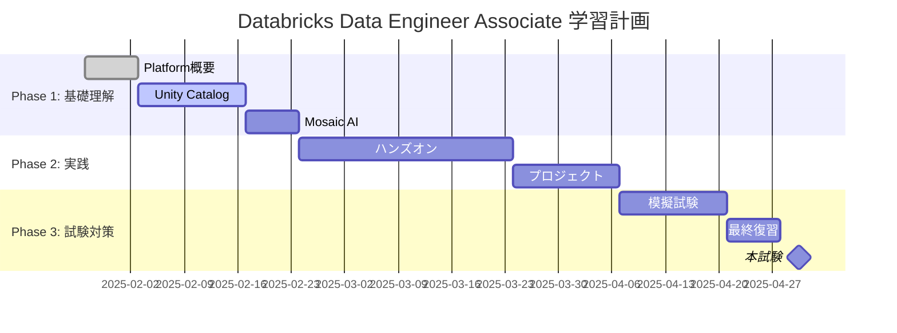

# Databricks Certified Data Engineer Associate 学習ノート（2025年版）

## 📋 資格概要

| 項目 | 詳細 |
|------|------|
| **資格名** | Databricks Certified Data Engineer Associate |
| **プラットフォーム** | Databricks Data Intelligence Platform |
| **レベル** | Associate |
| **試験時間** | 120分 |
| **問題数** | 45問 |
| **合格点** | 70% |
| **受験費用** | $200 |
| **有効期限** | 2年間 |
| **2025年アップデート** | Unity Catalog OSS、Mosaic AI、新ガバナンス機能 |

## 🎯 学習計画（2025年版対応）

### 目標設定
- **受験予定日**: 2025-04-30
- **学習開始日**: 2025-01-27
- **総学習時間目標**: 100時間（新機能学習込み）
- **週間学習時間**: 8時間/週

### 学習フェーズ
- [ ] **Phase 1**: Data Intelligence Platform基礎 (5週間)
- [ ] **Phase 2**: 実践・ハンズオン (6週間)  
- [ ] **Phase 3**: 模擬試験・総復習 (3週間)

## 📚 2025年版試験範囲・トピック

### ドメイン1: Databricks Data Intelligence Platform (28% ← 拡大)
- [ ] **レイクハウスアーキテクチャ**: 2025年版統合プラットフォーム
- [ ] **Data Intelligence Engine**: AI支援データ理解
- [ ] **Unity Catalog**: オープンソース版とエンタープライズ版
- [ ] **Mosaic AI統合**: LLM、Model Serving
- [ ] **セキュリティ・ガバナンス**: 2025年拡張機能
- [ ] **ワークスペース管理**: マルチクラウド対応

### ドメイン2: ELT with Spark SQL and Python (26% ← 調整)
- [ ] **Apache Spark + Photon Engine**: 最新性能最適化
- [ ] **Spark SQL**: 2025年新機能・関数
- [ ] **Python in Databricks**: 最新ライブラリ統合
- [ ] **DataFrames API**: 新機能・性能改善
- [ ] **Delta Lake**: 最新機能（Liquid Clustering等）

### ドメイン3: Incremental Data Processing (22% ← 調整)
- [ ] **Structured Streaming**: 高性能アーキテクチャ
- [ ] **Delta Live Tables**: 2025年新機能
- [ ] **Change Data Capture (CDC)**: 改善された実装
- [ ] **Lakeflow Pipelines**: 新データ統合機能
- [ ] **リアルタイムML**: ストリーミング推論

### ドメイン4: Production Pipelines (16%)
- [ ] **Lakeflow Jobs**: 新ワークフロー管理
- [ ] **Databricks CLI**: 最新コマンド
- [ ] **REST API**: 2025年拡張機能
- [ ] **Git統合**: 改善されたCI/CD
- [ ] **自動化・監視**: 新運用機能

### ドメイン5: Data Governance & AI (8% ← 新規拡大)
- [ ] **Unity Catalog詳細**: OSS vs エンタープライズ
- [ ] **AI Governance**: モデル管理・監視
- [ ] **データリネージュ**: AI資産追跡
- [ ] **セキュリティ**: ABAC、Data Classification
- [ ] **Delta Sharing**: オープンデータ共有

## 📈 学習進捗トラッキング

### 週次レビュー
| 週 | 期間 | 計画学習時間 | 実績学習時間 | 達成トピック | 理解度 |
|----|------|-------------|-------------|-------------|--------|
| W1 | 01/27-02/02 | 8h | 4h | Data Intelligence Platform概要 | Low |
| W2 | 02/03-02/09 | 8h | - | Unity Catalog OSS | - |
| W3 | 02/10-02/16 | 8h | - | Mosaic AI基礎 | - |

### 2025年版重点学習トピック
- **Unity Catalog OSS**: オープンソース版の特徴と制限
- **Mosaic AI**: LLM統合、Model Serving
- **Data Intelligence Engine**: AI支援機能
- **Lakehouse Federation**: 外部データソース統合
- **新ガバナンス機能**: ABAC、自動分類

## 🔬 実習・ハンズオン記録（2025年版）

### 完了済み実習
- [ ] [[Databricks_Community_Edition_Setup_2025]] - 2025年版セットアップ
- [ ] [[Unity_Catalog_OSS_Lab]] - オープンソース版体験
- [ ] [[Mosaic_AI_Quickstart]] - AI機能基礎
- [ ] [[Delta_Lake_Advanced_Features]] - 最新機能（Liquid Clustering等）
- [ ] [[Structured_Streaming_Performance]] - 高性能ストリーミング

### 2025年版実習メモ
```python
# Unity Catalog OSS接続例
from databricks.labs.unitycatalog import UnityCatalog

# Mosaic AI Model Serving
from databricks.model_serving import ModelServingClient

# 新しいDelta Lake機能
spark.sql("CREATE TABLE IF NOT EXISTS events 
           USING DELTA 
           CLUSTER BY (user_id)")  # Liquid Clustering
```

### トラブルシューティング・注意点
- Unity Catalog OSS: エンタープライズ機能との違いに注意
- Mosaic AI: 課金体系が従来と異なる
- Liquid Clustering: パーティション戦略の見直しが必要

## 📝 模擬試験結果

| 実施日 | 試験名 | スコア | 正答率 | 弱点分野 | アクション |
|--------|--------|--------|--------|----------|-----------|
| - | 2025年版模擬試験1 | - | - | - | - |
| - | 公式練習問題 | - | - | - | - |

## 🎓 2025年版試験対策

### 重要ポイント・よく出る問題
- **Unity Catalog**: OSS版とエンタープライズ版の機能差異
- **Mosaic AI**: LLMサービングの設定と制限
- **Data Intelligence Engine**: AI支援機能の活用方法
- **新ガバナンス**: ABACポリシーの設定
- **Delta Lake**: Liquid Clusteringの最適化

### 2025年新出題領域
- **AI統合**: モデルライフサイクル管理
- **オープンソース**: Unity Catalog OSS活用
- **高度ガバナンス**: 属性ベースアクセス制御
- **データ共有**: Delta Sharingプロトコル

### 試験テクニック（2025年版）
- 新機能問題: 公式ドキュメントの用語を正確に覚える
- AI関連問題: Mosaic AIとSparkMLの使い分けを理解
- ガバナンス問題: Unity Catalogの階層構造を把握
- 実装問題: 新syntax・APIの正確な記述

## 📖 学習リソース（2025年版）

### 公式教材
- [ ] [[Databricks_Academy_Data_Engineer_2025]] - 最新トレーニング
- [ ] [[Data_Intelligence_Platform_Documentation]] - 2025年版公式docs
- [ ] [[Unity_Catalog_OSS_Documentation]] - オープンソース版ガイド

### 2025年新規追加教材
- [ ] [[Mosaic_AI_Learning_Path]] - AI機能専用コース
- [ ] [[Lakehouse_Federation_Guide]] - 外部統合ガイド
- [ ] [[Advanced_Governance_Patterns]] - ガバナンス実装パターン

### 実践環境
- **Databricks Community Edition**: 一部新機能制限あり
- **Databricks Trial**: 最新機能フル体験（14日間）
- **Unity Catalog OSS**: ローカル環境での学習可能

## 💡 学習メモ・気づき（2025年版）

### 今日の学習メモ
```
2025年版の大きな変化:
- Unity CatalogのOSS化でエコシステムが拡大
- Mosaic AIによりプラットフォームのAI統合が大幅強化
- Data Intelligence Engineで従来の「データ」から「インテリジェンス」へ進化
- オープンスタンダード対応が競合との差別化要因
```

### 重要な気づき・洞察
- **2025年のトレンド**: AIとデータの境界がなくなる統合プラットフォーム
- **試験対策**: 従来のSparkスキルに加えてAI/ML理解が必須
- **実務応用**: ガバナンス機能がエンタープライズ採用の鍵
- **将来性**: オープンソース戦略が長期的競争優位性を生む

### 2025年版学習ポイント
1. **AI統合理解**: Mosaic AIのアーキテクチャと制限
2. **オープン性**: Unity Catalog OSSの戦略的意義
3. **ガバナンス**: エンタープライズセキュリティ要件
4. **性能**: Photon Engineによる最適化効果

## 🔗 関連ノート
- [[Data_Intelligence_Platform_Overview_2025]] - プラットフォーム全体像
- [[Unity_Catalog_OSS_vs_Enterprise]] - 機能比較詳細
- [[Mosaic_AI_Architecture]] - AI統合アーキテクチャ
- [[Databricks_vs_Snowflake_2025]] - 最新競合比較

## 📊 2025年版学習ロードマップ



---

**最終更新**: 2025-01-27  
**次回レビュー予定**: 2025-02-03  
**現在の信頼度**: Medium（2025年版機能対応）  
**プラットフォームバージョン**: Data Intelligence Platform 2025