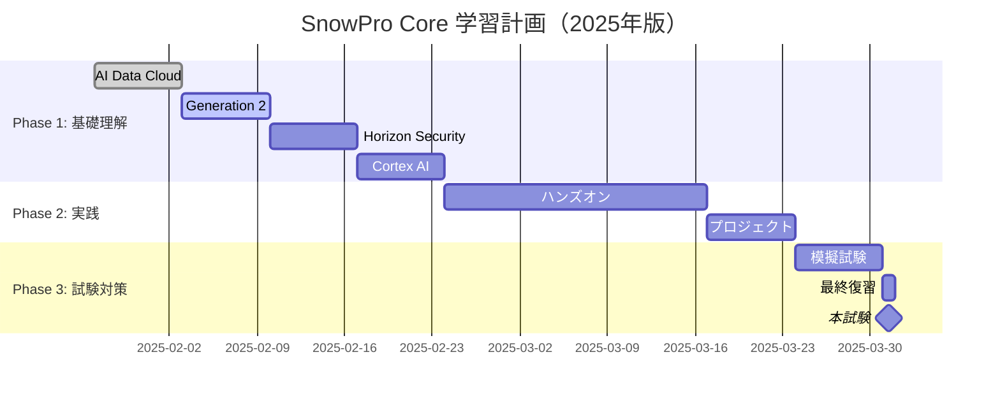

# SnowPro Core Certification 学習ノート（2025年版）

## 📋 資格概要

| 項目 | 詳細 |
|------|------|
| **資格名** | SnowPro Core Certification |
| **プラットフォーム** | Snowflake AI Data Cloud |
| **レベル** | Foundation |
| **試験時間** | 115分 |
| **問題数** | 100問 |
| **合格点** | 80% |
| **受験費用** | $175 |
| **有効期限** | 2年間 |
| **2025年アップデート** | AI Data Cloud、Cortex AI、Horizon、Generation 2 |

## 🎯 学習計画（2025年版対応）

### 目標設定
- **受験予定日**: 2025-03-31
- **学習開始日**: 2025-01-27
- **総学習時間目標**: 80時間
- **週間学習時間**: 10時間/週

### 学習フェーズ
- [ ] **Phase 1**: AI Data Cloud基礎理解 (4週間)
- [ ] **Phase 2**: 実践・ハンズオン (5週間)  
- [ ] **Phase 3**: 模擬試験・総復習 (2週間)

## 📚 2025年版試験範囲・トピック

### ドメイン1: Snowflake AI Data Cloud概要 (25% ← 新規拡大)
- [ ] **AI Data Cloudアーキテクチャ**: 統合プラットフォーム概念
- [ ] **4層アーキテクチャ**: Storage、Compute、Services、Snowgrid
- [ ] **クラウドサービス層**: 自動化・管理機能
- [ ] **Snowgrid**: グローバル接続・データ共有
- [ ] **Generation 2 Warehouses**: 2.1x性能向上
- [ ] **Adaptive Compute**: 自動スケーリング・最適化

### ドメイン2: Account Access and Security (20%)
- [ ] **Multi-factor Authentication**: 新MFA方式
- [ ] **Network Security**: IP Allow Lists、Private Link
- [ ] **User Management**: RBAC、SCIM統合
- [ ] **Snowflake Horizon**: 統合ガバナンス・セキュリティ
- [ ] **Data Classification**: 自動分類・タグ付け
- [ ] **アクセス制御**: Object-level権限

### ドメイン3: Virtual Warehouses (15% ← 調整)
- [ ] **Generation 2機能**: パフォーマンス向上詳細
- [ ] **Adaptive Warehouses**: インテリジェント・ルーティング
- [ ] **サイジング戦略**: 2025年版ベストプラクティス
- [ ] **自動サスペンド/再開**: 新しい自動化機能
- [ ] **Multi-cluster Warehouses**: 同時実行最適化
- [ ] **Serverless Warehouses**: 新課金モデル

### ドメイン4: Databases and Data Sharing (15%)
- [ ] **Database Objects**: Tables、Views、Functions
- [ ] **Secure Data Sharing**: 新機能・制限
- [ ] **Snowflake Marketplace**: データ製品・アプリ
- [ ] **Semantic Views**: BI・AI統合（新機能）
- [ ] **Data Products**: Marketplace統合
- [ ] **Cross-cloud Sharing**: マルチクラウド対応

### ドメイン5: Moving Data (10%)
- [ ] **Snowflake Openflow**: Apache NiFi統合
- [ ] **Data Loading**: COPY、Snowpipe、Streaming
- [ ] **Snowpipe Streaming**: リアルタイム取り込み
- [ ] **External Tables**: クラウドストレージ統合
- [ ] **Data Unloading**: UNLOAD機能
- [ ] **Change Data Capture**: CDC実装

### ドメイン6: Performance and Optimization (10%)
- [ ] **Query Performance**: 実行計画・最適化
- [ ] **Caching**: Result Cache、Warehouse Cache
- [ ] **Clustering**: Automatic Clustering詳細
- [ ] **Materialized Views**: 性能向上手法
- [ ] **Query Acceleration Service**: 新機能
- [ ] **Performance Monitoring**: 監視・分析ツール

### ドメイン7: AI/ML Integration (5% ← 新規追加)
- [ ] **Snowflake Cortex AI**: LLM統合基礎
- [ ] **Cortex Functions**: AI/ML SQL関数
- [ ] **Snowflake Intelligence**: 基本概念
- [ ] **ML Model Management**: モデル管理基礎
- [ ] **AI Data Governance**: AI資産管理

## 📈 学習進捗トラッキング

### 週次レビュー
| 週 | 期間 | 計画学習時間 | 実績学習時間 | 達成トピック | 理解度 |
|----|------|-------------|-------------|-------------|--------|
| W1 | 01/27-02/02 | 10h | - | AI Data Cloud概要 | - |
| W2 | 02/03-02/09 | 10h | - | Generation 2機能 | - |
| W3 | 02/10-02/16 | 10h | - | Horizon・セキュリティ | - |

### 2025年版重点学習トピック
- **AI Data Cloud**: 統合プラットフォームの理解
- **Generation 2**: 新性能向上機能
- **Horizon**: 統合ガバナンス・セキュリティ
- **Openflow**: 新データ統合機能
- **Cortex AI**: 基本的なAI機能理解

## 🔬 実習・ハンズオン記録（2025年版）

### 完了済み実習
- [ ] [[Snowflake_Free_Trial_Setup_2025]] - 最新トライアル環境
- [ ] [[Generation_2_Warehouse_Performance]] - 新ウェアハウス体験
- [ ] [[Horizon_Security_Lab]] - セキュリティ機能実習
- [ ] [[Cortex_AI_Basic_Functions]] - AI機能基礎
- [ ] [[Semantic_Views_Introduction]] - 新BI統合機能

### 2025年版実習メモ
```sql
-- Generation 2 Warehouse作成例
CREATE WAREHOUSE gen2_wh WITH
  WAREHOUSE_SIZE = 'SMALL'
  WAREHOUSE_TYPE = 'STANDARD_GEN2'
  AUTO_SUSPEND = 60
  AUTO_RESUME = TRUE;

-- Cortex AI関数例
SELECT SNOWFLAKE.CORTEX.SUMMARIZE(
  'Given the document text, provide a summary',
  document_text
) FROM documents;

-- Semantic View作成例
CREATE SEMANTIC VIEW sales_semantic_view (
  TABLES (
    sales_fact,
    date_dim,
    product_dim
  )
  RELATIONSHIPS (
    sales_fact.date_key REFERENCES date_dim.date_key
  )
  METRICS (
    total_sales AS SUM(sales_amount)
  )
);
```

### トラブルシューティング・注意点
- Generation 2: 従来のStandardとの違いを理解
- Horizon: 既存セキュリティ機能との統合関係
- Cortex AI: 課金・利用制限の理解

## 📝 模擬試験結果

| 実施日 | 試験名 | スコア | 正答率 | 弱点分野 | アクション |
|--------|--------|--------|--------|----------|-----------|
| - | 2025年版模擬試験1 | - | - | - | - |
| - | 公式サンプル問題 | - | - | - | - |

## 🎓 2025年版試験対策

### 重要ポイント・よく出る問題
- **AI Data Cloud**: 4層アーキテクチャの理解
- **Generation 2**: 性能向上の具体的数値（2.1x）
- **Horizon**: 統合ガバナンス機能の範囲
- **Adaptive Compute**: 自動最適化の仕組み
- **Semantic Views**: BI・AI統合の概念

### 2025年新出題領域
- **AI統合**: Cortex AI基本機能
- **新アーキテクチャ**: Generation 2詳細
- **統合ガバナンス**: Horizon機能範囲
- **データ統合**: Openflow基本概念

### 試験テクニック（2025年版）
- 新機能問題: 公式用語を正確に覚える
- アーキテクチャ問題: 4層構造の詳細理解
- 性能問題: Generation 2の改善点把握
- セキュリティ問題: Horizonの統合機能理解

## 📖 学習リソース（2025年版）

### 公式教材
- [ ] [[Snowflake_University_Core_2025]] - 最新公式コース
- [ ] [[AI_Data_Cloud_Documentation]] - 2025年版公式ドキュメント
- [ ] [[Hands_On_Labs_2025]] - 最新ハンズオン環境

### 2025年新規追加教材
- [ ] [[Generation_2_Performance_Guide]] - 新ウェアハウス詳細
- [ ] [[Horizon_Security_Framework]] - 統合セキュリティ
- [ ] [[Cortex_AI_Getting_Started]] - AI機能入門

### 実践環境
- **Snowflake Free Trial**: 最新機能フル体験（30日間）
- **Hands-on Labs**: Snowflake University提供
- **Community Edition**: 基本機能学習

## 💡 学習メモ・気づき（2025年版）

### 今日の学習メモ
```
2025年版の大きな変化:
- AI Data Cloudへの進化で従来のデータウェアハウスから統合プラットフォームへ
- Generation 2による大幅な性能向上（2.1x）
- Horizonによる統合ガバナンス・セキュリティ
- Cortex AIでAI機能がネイティブ統合
- Semantic ViewsでBI・AI統合が標準化
```

### 重要な気づき・洞察
- **2025年のトレンド**: データ基盤からAI統合プラットフォームへの進化
- **試験対策**: 従来のDWH知識に加えてAI統合理解が必要
- **実務応用**: ガバナンス・セキュリティの統合が競争優位性
- **将来性**: AI機能のネイティブ統合が差別化要因

### 2025年版学習ポイント
1. **AI Data Cloud理解**: 統合プラットフォーム概念の習得
2. **新機能習得**: Generation 2、Horizon、Cortex AI
3. **ガバナンス**: 統一セキュリティフレームワーク
4. **パフォーマンス**: 最新最適化技術の理解

## 🔗 関連ノート
- [[Snowflake_AI_Data_Cloud_Architecture_2025]] - プラットフォーム詳細
- [[Generation_2_vs_Standard_Warehouses]] - 性能比較
- [[Horizon_Security_Framework_Details]] - セキュリティ詳細
- [[Databricks_vs_Snowflake_2025]] - 競合比較

## 📊 2025年版学習ロードマップ



## 🎯 認定後のキャリアパス

### 上位認定への道筋
- **SnowPro Advanced: Architect**: システム設計・アーキテクチャ
- **SnowPro Advanced: Administrator**: 運用・管理・セキュリティ
- **SnowPro Advanced: Data Engineer**: データパイプライン・ETL
- **SnowPro Advanced: Data Scientist**: AI/ML・データサイエンス

### 実務スキル向上
- **AI Data Cloud設計**: エンタープライズアーキテクチャ
- **ガバナンス実装**: Horizon活用セキュリティ
- **パフォーマンス最適化**: Generation 2活用
- **AI統合**: Cortex AI実装

## 📚 追加学習教材

### 公式リソース
- [Snowflake Documentation](https://docs.snowflake.com/)
- [Snowflake University](https://learn.snowflake.com/)
- [Hands-on Labs](https://quickstarts.snowflake.com/)

### コミュニティ・実践
- [Snowflake Community](https://community.snowflake.com/)
- [YouTube - Snowflake](https://www.youtube.com/c/SnowflakeInc)
- [Snowflake Blog](https://www.snowflake.com/blog/)

---

**最終更新**: 2025-01-27  
**次回レビュー予定**: 2025-02-03  
**現在の信頼度**: Low（2025年版機能学習開始）  
**プラットフォームバージョン**: AI Data Cloud 2025 